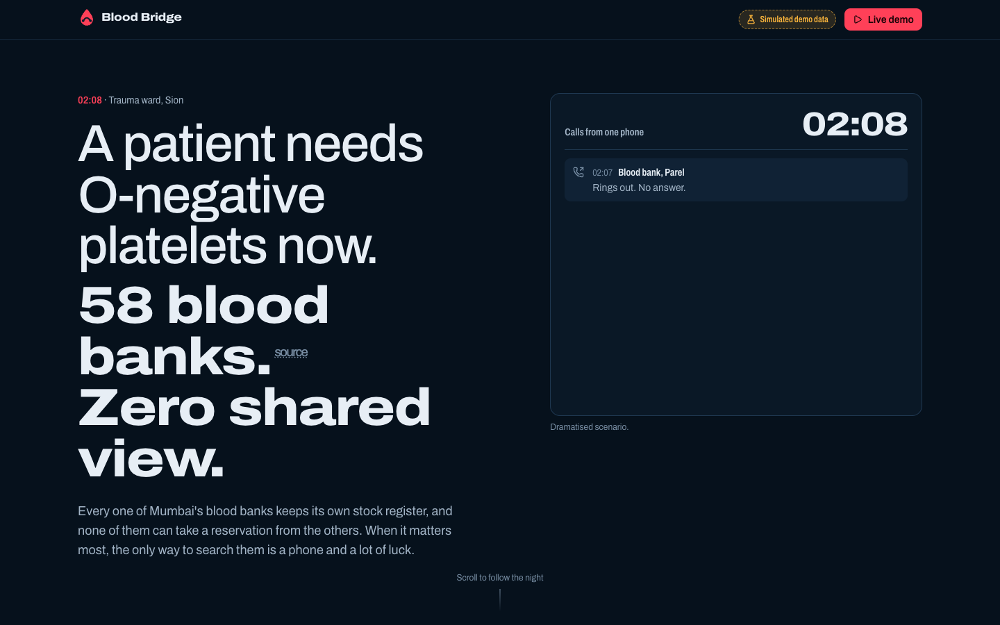
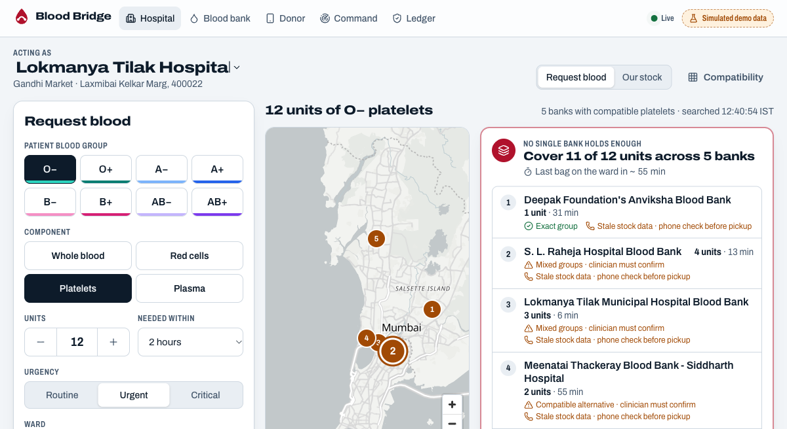
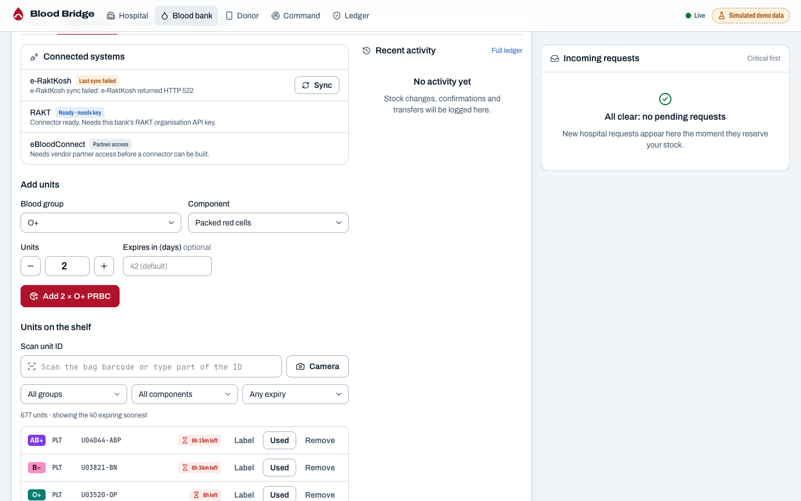
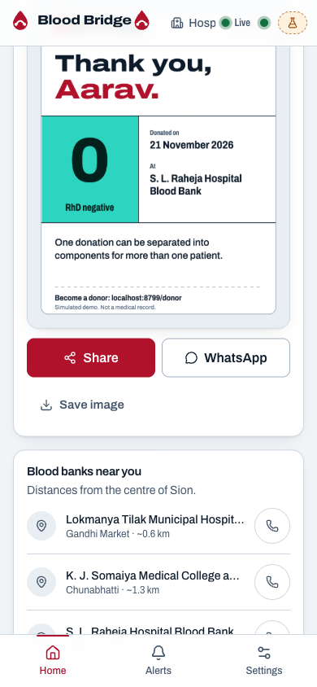
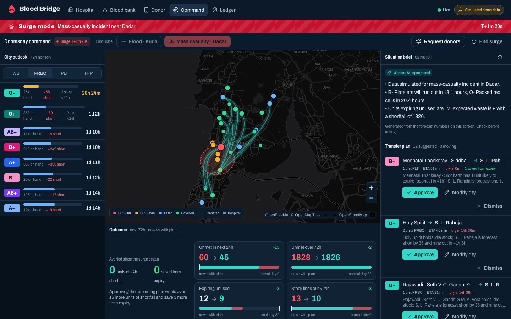
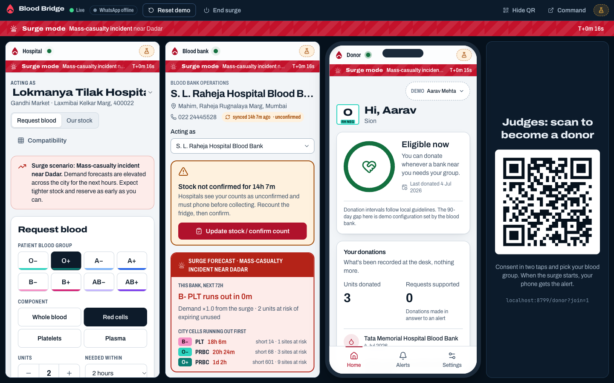
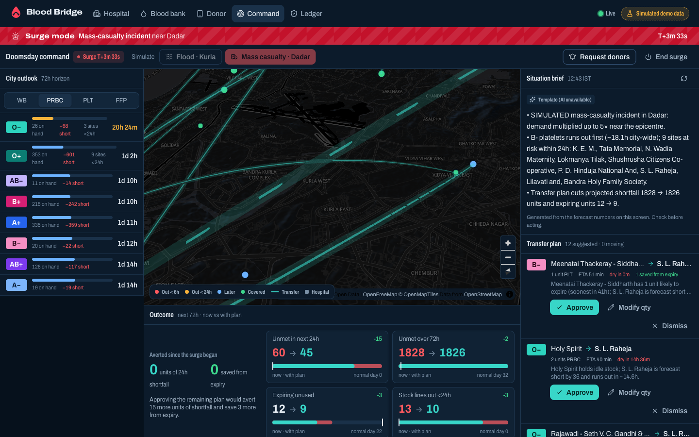
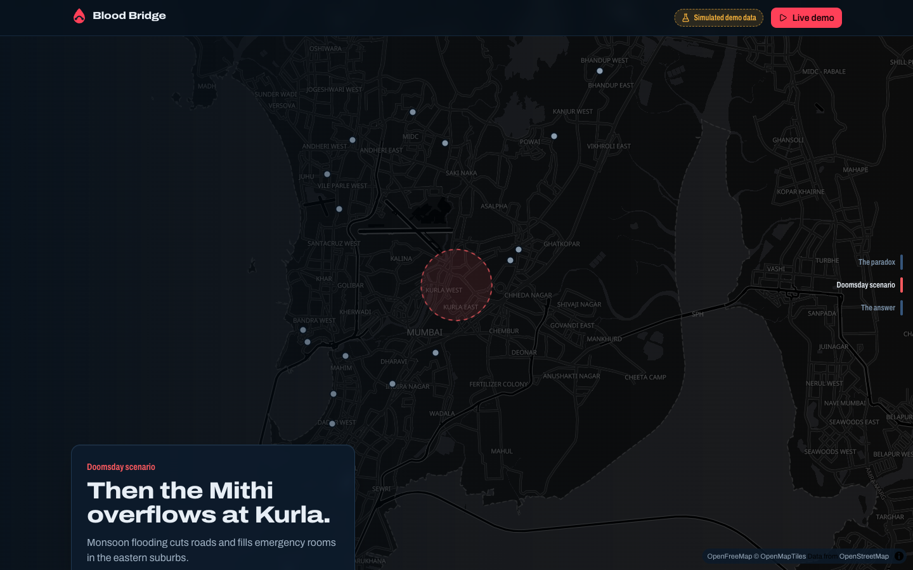

<div align="center">

# 🩸 Blood Bridge

**When a patient needs blood now, one screen shows compatible, in-date stock across Mumbai's blood banks, reserves it in one tap, and — when the city is under stress — forecasts shortages and moves blood and donors before they run out.**

[**Live demo →**](https://blood-bridge.blood-bridge.workers.dev) · [Stage view](https://blood-bridge.blood-bridge.workers.dev/stage) · [Doomsday command](https://blood-bridge.blood-bridge.workers.dev/command)

MindSprint 2026 · Open Innovation (Doomsday) · Team Straw Hats




</div>

---

## The problem

A ward needs a specific blood component **now**. Stock and expiry information sit in separate blood banks, so families and staff phone around and post on WhatsApp. Meanwhile one bank lets units expire while the next one runs dry.

- India is roughly **1 million units short every year** — while **28 lakh units were discarded in five years**, mostly to expiry ([sources](docs/PROBLEM_RESEARCH.md)).
- Mumbai has **58 blood banks** and no shared way to reserve a unit.
- The national portal's data for Mumbai banks was **4–22 hours old** when we snapshotted it — it can't tell a hospital what is on the shelf right now.
- Tonight's real data: only **7 O-negative platelet units across 25 Mumbai banks**, and just one bank held two or more.

In a flood or mass-casualty event, this coordination failure becomes dangerous.

## What Blood Bridge does

| | |
|---|---|
| 🏥 **Hospital** — find compatible, in-date stock ranked by distance, data freshness and expiry; reserve in one tap; track it live. If no single bank has enough, **cover the request across several banks in one tap**. |  |
| 🧪 **Blood bank** — live request queue (confirm / partial / decline), stock by group × component, camera barcode scanning, expiry-aware transfer suggestions, consent-respecting donor drives, and **connected systems** (e-RaktKosh, RAKT). |  |
| 📱 **Donor** — signs up in 20 seconds from a QR, controls three separate consents, gets alerts only when eligible, nearby and needed (in Hindi / Marathi too), and receives a shareable certificate and an "eligible again" reminder. |  |

### The wow moment — Doomsday surge mode

Trigger a simulated flood at Kurla (Mithi river) or a mass-casualty incident at Dadar. The 3D city map forecasts which blood groups run out first and where, proposes expiry-aware transfers drawn as arcs, and a before/after meter shows the shortage the plan averts. An open model on Workers AI writes the situation brief.



<details>
<summary>More screenshots</summary>

**Stage view** — all three roles side by side, plus a QR for judges to become donors live:



**3D map, zoomed in** — tilt, rotate and extruded buildings (MapLibre + OpenFreeMap):



**Landing page** — problem-first scroll story with a pinned flood map:



</details>

## Features

- **Ranked search** with a per-component compatibility gate (labelled demo logic; every non-exact match flagged for clinician confirmation).
- **One-tap reservation** with a live tracker; the bank has 90 s to confirm, then the request **auto-reroutes** to the next-best bank. Uncollected holds return to stock.
- **Split reservation** across multiple banks when stock is scattered.
- **Data freshness everywhere** — stale stock is marked unconfirmed and requires a phone check.
- **Expiry-aware transfer planner** and **surge forecast** (rule-based, explainable: units on hand ÷ hourly demand, minus what expires first).
- **Consent-first donor alerts** — group match, eligibility, range, consent, quiet hours and a weekly cap; the operator sees the funnel *before* sending; donor identity is revealed only after they tap "I can come".
- **Tamper-evident audit ledger** — every action is hash-chained; editing history breaks verification.
- **Real-time sync** of every open screen via a Durable Object WebSocket hub.
- **MCP server (15 tools)** — connect ChatGPT or Claude and run the city in plain English. Read tools are open; actions require a token *and* explicit confirmation, and are logged as `ai:<client>`. See [docs/MCP.md](docs/MCP.md).
- **WhatsApp bot** — "Sion mein 2 O negative platelets chahiye" returns the top 3 real banks; donors JOIN, reply YES for a confirmation code, STOP to opt out. See [docs/MESSAGING.md](docs/MESSAGING.md).
- **Connected systems** — e-RaktKosh live sync (via an India relay, as the portal blocks cloud servers) and a RAKT blood-bank-software connector built to its published OpenAPI schema.

## Real vs simulated data

| | |
|---|---|
| **Real (open data)** | 25 Mumbai blood banks + 6 municipal hospitals (data.gov.in, OpenStreetMap); stock counts by group × component and each bank's last-update time (e-RaktKosh); shelf lives (Drugs Rules G.S.R. 166(E) 2020); blood-group shares and collection volumes (cited) |
| **Modelled** | Per-bag expiry dates (e-RaktKosh publishes counts only), daily demand, surge multipliers (cited assumptions) |
| **Synthetic** | Every donor, patient and request — no real personal data is used |

Full provenance and licences: [docs/DATA_SOURCES.md](docs/DATA_SOURCES.md).

## Architecture

```
            ┌──────────────────────── one Cloudflare Worker ────────────────────────┐
 Browser ──▶│ React 19 SPA (static assets) │ Hono API /api/* │ MCP server /mcp       │
 ChatGPT ──▶│                              │                 │                       │
 Claude  ──▶│        D1 (SQLite, Drizzle)  ◀─────────────────┤ Workers AI (open      │
            │        CityHub Durable Object: WebSockets, hash-chained ledger,        │
            │        auto-reroute alarm                       │  models: brief,       │
            └────────────────────────────▲────────────────────┘  translation)       ┘
                                         │ outbound only
                     Laptop gateway (Node): WhatsApp (open-wa) + e-RaktKosh India relay
```

All domain logic (`src/shared`) is pure TypeScript shared by the Worker and the UI: compatibility, ranking, FIFO expiry-aware forecast, transfer planner, donor targeting — covered by unit tests.

**Stack:** Cloudflare Workers · D1 · Durable Objects · Workers AI · React 19 · Vite · Tailwind v4 · TanStack Query · Zod · MapLibre GL + OpenFreeMap + deck.gl · Model Context Protocol SDK · open-wa · ZXing · Vitest.

## For frontend developers — start here

Two ways to work, pick one:

**A. Use the live API (zero setup).** Point your app at `https://blood-bridge.blood-bridge.workers.dev/api` — CORS is open, realtime is at `wss://blood-bridge.blood-bridge.workers.dev/api/realtime`. Please **don't call `POST /api/demo/reset` on the live API** while a demo is running: the data is shared.

**B. Run the whole backend on your machine (recommended for building).** Your own private database, no Cloudflare account needed:

```bash
git clone https://github.com/Sayuj63/blood-bridge.git && cd blood-bridge
pnpm install
pnpm db:migrate:local                         # creates the local SQLite database
pnpm dev                                      # API + current UI on http://localhost:5173
curl -X POST http://localhost:5173/api/demo/reset   # loads the Mumbai demo city (25 real banks)
```

Everything you need is in **[docs/API.md](docs/API.md)** (every endpoint, request/response types, realtime events, flows in call order). Types to copy: [`src/shared/api.ts`](src/shared/api.ts) + [`src/shared/domain.ts`](src/shared/domain.ts). A working typed client: [`src/web/lib/api.ts`](src/web/lib/api.ts). The existing UI in `src/web/` is a full reference implementation you can reuse or replace.

Locally, the AI brief and translations use templates (Workers AI needs a Cloudflare login: run `CF_REMOTE=1 pnpm dev` if you have one).

## Run it locally

```bash
pnpm install
pnpm db:migrate:local && pnpm dev           # then: curl -X POST localhost:5173/api/demo/reset
pnpm test                                   # 135 unit tests
node scripts/smoke.mjs <base-url>           # end-to-end demo check (resets data!)
pnpm run deploy                             # build + wrangler deploy
```

Optional WhatsApp + e-RaktKosh relay: `pnpm --dir gateway install && pnpm --dir gateway start` (see [docs/MESSAGING.md](docs/MESSAGING.md)).

## Demo routes

| Route | What it shows |
|---|---|
| `/` | The problem, told as a scroll story (sources footnoted) |
| `/stage` | Hospital · Blood bank · Donor phone side by side + judge QR |
| `/command` | Doomsday surge mode |
| `/hospital` · `/bank` · `/donor` | The three role views |
| `/ledger` | Tamper-evident activity log — try "tamper", then "verify" |

## Safety & scope

Simulated demo data only; every screen says so. Compatibility rules and eligibility intervals are simplified demo logic, clearly labelled — clinicians confirm every non-exact match, and the system suggests while humans decide. This is a hackathon prototype, not a medical device.

## Docs

[**API reference (for frontend)**](docs/API.md) · [Problem research](docs/PROBLEM_RESEARCH.md) · [Judge playbook & pitch](docs/JUDGE_PLAYBOOK.md) · [Data sources](docs/DATA_SOURCES.md) · [MCP](docs/MCP.md) · [Messaging](docs/MESSAGING.md) · [Build status (PDF)](docs/Blood-Bridge-Status.pdf)

<div align="center"><sub>Built by Team Straw Hats for MindSprint 2026.</sub></div>
